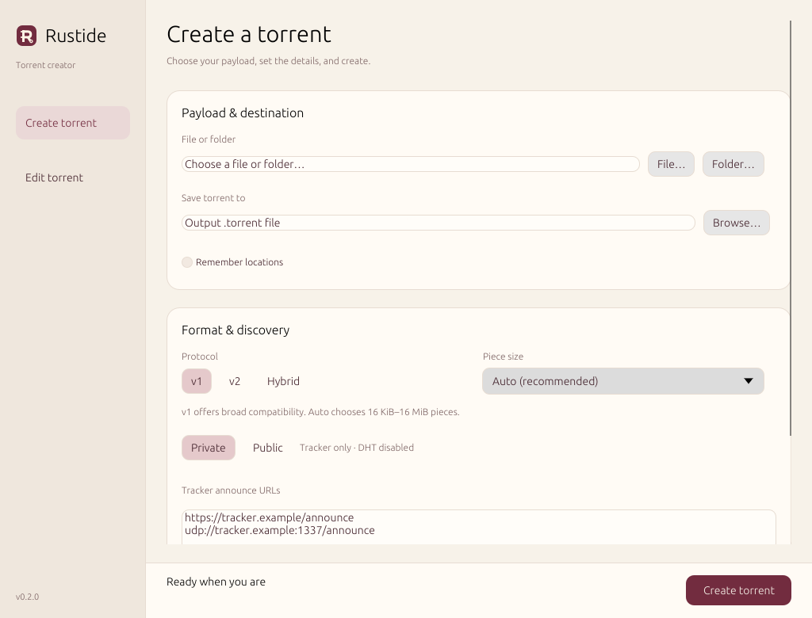

# Rustide

A fast torrent creator and metadata editor for Linux and Windows. A desktop interface and command line in one portable executable, with no runtime to install.

```sh
rustide /path/to/file-or-folder output.torrent
```

Rustide hashes pieces in parallel and selects hardware SHA instructions or wide-vector SHA-1 at runtime. On Linux SSDs, direct reads avoid page-cache and mapping overhead for v1 hashing. A bounded sequential reader handles hard disks, with mapped reads available for other workloads. The same download works on older and newer processors.

## Download

Get a binary from [Releases](https://github.com/720pixel/Rustide/releases).

| System | Download |
| --- | --- |
| Linux x86_64 | Static executable in the `linux-x86_64` archive |
| Linux ARM64 | Static executable in the `linux-aarch64` archive |
| Windows x86_64 | `rustide.exe`, or the Windows archive |

Linux binaries include their runtime. No root access or shared-library packages are required. Windows binaries do not need a separate runtime installation.

## Desktop interface

Download and run the executable with no arguments to open the desktop interface. The same executable accepts every CLI command below. To open the interface from a terminal:

```sh
rustide gui
```

The Create view offers file and folder selection, automatic piece sizing, v1/v2/hybrid formats, tracker tiers, web seeds, DHT nodes, and checksums. Private is selected initially. Choose Public to enable DHT and the [public tracker preset](https://opentrackr.org/).

After a successful private creation, its tracker URLs appear in the Recent trackers menu. The history is saved in your user settings and can be cleared from that menu. The progress bar shows hashing, throughput, time remaining, workers, and backends. Auto selects pieces up to 16 MiB; manual sizes up to 64 MiB are available.



On Windows, Browse opens the standard Explorer file and folder dialogs. **Remember locations**, beneath the output path, is off by default; when enabled, it saves the last input, output, and opened torrent folders. Turning it off clears those saved folders.

The Edit view offers common metadata fields and a searchable field tree. Add, change, or remove strings, integers, lists, dictionaries, and binary values. Unknown fields are preserved, and piece hashes stay protected unless explicitly unlocked. Existing files require replacement confirmation; edits are saved atomically.

Linux desktops need an X11 or XWayland display. Rendering is done in software, with no graphics driver or GUI toolkit packages to install. Windows uses its built-in desktop APIs. No installer is required.

On Linux, extract the archive and run:

```sh
chmod +x rustide
./rustide ./data data.torrent
```

## Create

The default format is BitTorrent v1. Files are sorted deterministically, and pieces that cross file boundaries are hashed as one continuous byte stream.

```sh
rustide ./data data.torrent
rustide ./data data.torrent --private --source Example --announce https://tracker.example/announce
rustide ./data data.torrent --protocol hybrid
rustide ./data data.torrent --protocol v2
```

Automatic piece selection targets roughly 1,000 pieces: divide the payload size by 1,000, round up to a power of two, and clamp to 16 KiB–16 MiB. Automatic selection never uses 32 MiB or 64 MiB.

Set an exact piece size when needed:

```sh
rustide ./data data.torrent --piece-size 8MiB
rustide ./data data.torrent --piece-size 32MiB
rustide ./data data.torrent --piece-size 64MiB
```

Sizes also accept bytes and power-of-two exponents: `--piece-size 24` means 16 MiB.

The worker pool is chosen from available CPUs, storage type, memory, and the amount of work. Override it with `--threads 16`. More workers can add overhead once storage throughput is saturated.

Use `--io direct`, `--io mmap`, or `--io buffered` to choose the read method explicitly. Direct reads use bounded file handles for large directories and support pieces that cross files, falling back to buffered reads where needed. Keep input files unchanged while they are being hashed.

Creation shows a compact progress line on stderr: percentage, hashed bytes, average throughput, and estimated time remaining. The header shows piece size, workers, and the selected hashing and read backends. Hybrid torrents show each hashing pass separately. Redirected output uses occasional plain lines; `--simple-progress` also selects this format in a terminal. Use `--quiet` to hide progress. JSON output stays silent on stderr unless `--simple-progress` is requested; binary stdout remains separate from progress.

Other creation options include:

- Tracker tiers and named groups, web seeds, HTTP seeds, and DHT nodes.
- Comments, source tags, private flags, creation dates, and creator names.
- File filters with `--include` and `--exclude`, plus hidden-file and symlink controls.
- Optional per-file SHA-1, SHA-256, SHA-512, and MD5 checksums.
- Related-torrent hashes and collection tags.
- `--dry-run`, JSON statistics, binary output to stdout, and explicit overwrite control.

Run `rustide create --help` for the full option list. Existing output files require `--force`.

## Inspect and edit

```sh
rustide info data.torrent
rustide info data.torrent --json
rustide show infohash data.torrent
rustide show files data.torrent
rustide show query data.torrent /info/name
rustide magnet data.torrent

rustide edit data.torrent --comment "Updated description"
rustide edit data.torrent --announce https://tracker.example/announce --list-mode append
rustide edit data.torrent --private on --source Example --output private.torrent
```

Editing updates metadata without reading the payload again. Unknown fields are preserved. In-place edits use an atomic replacement; a separate output needs `--force` if it already exists.

## Verify

```sh
rustide verify data.torrent /path/to/data
rustide verify data.torrent /path/to/data --json
rustide pad data.torrent /path/to/data
```

Verification checks v1 piece hashes and v2 file roots. A mismatch returns a nonzero exit code. Padding files are synthesized during verification; `pad` writes missing padding files when they are needed on disk.

## Configuration

Configuration is optional. Use `--config settings.json`, or place `config.json` in `$XDG_CONFIG_HOME/rustide` on Linux (normally `~/.config/rustide`) or `%APPDATA%\rustide` on Windows.

```json
{
  "tracker_groups": {
    "example": ["https://tracker.example/announce"]
  },
  "profiles": {
    "private": {
      "command": "create",
      "options": {
        "private": true,
        "protocol": "v1",
        "piece-size": "8MiB",
        "announce-group": "example"
      }
    }
  }
}
```

```sh
rustide ./data data.torrent --profile private
rustide system ./data
```

Explicit command-line options take precedence over profile values. Named tracker entries support abbreviations and URL parameters through `trackers` and `tracker_parameters`.

## Build

Rust 1.89 or newer. See [build instructions](docs/build.md) for static Linux and Windows releases.

```sh
cargo build --release --locked
cargo test --locked
```

## License

MIT. See [LICENSE](LICENSE).
